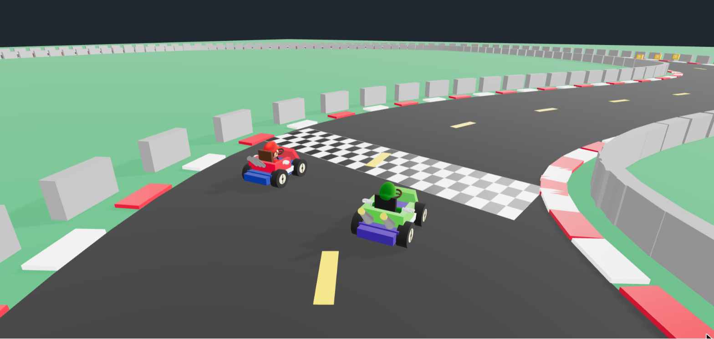
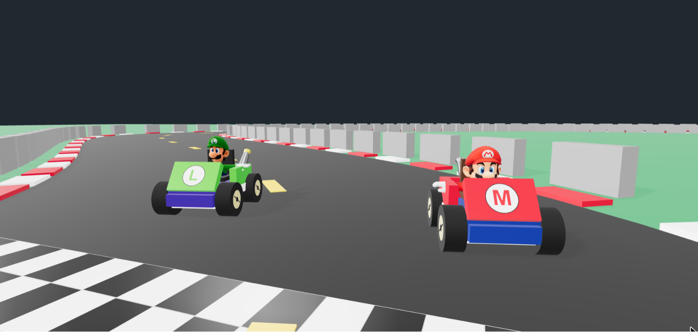
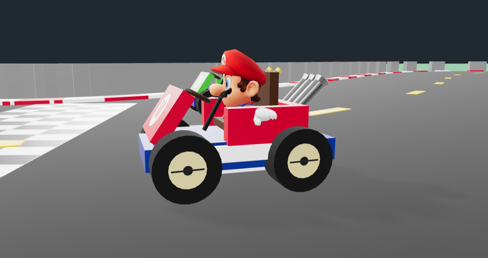
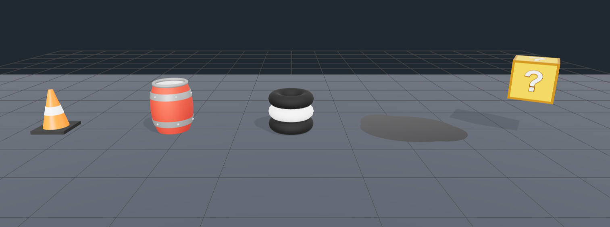
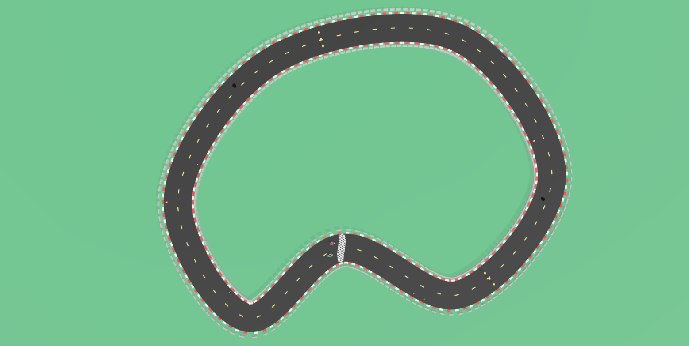
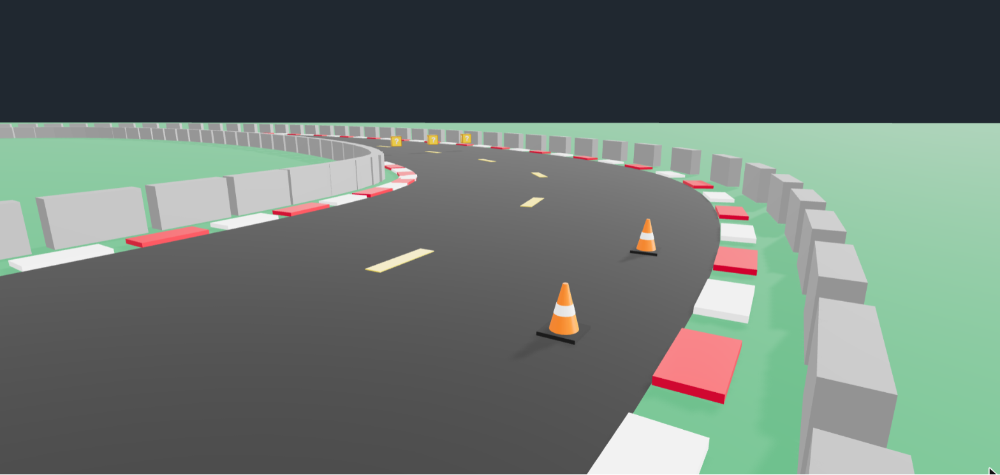
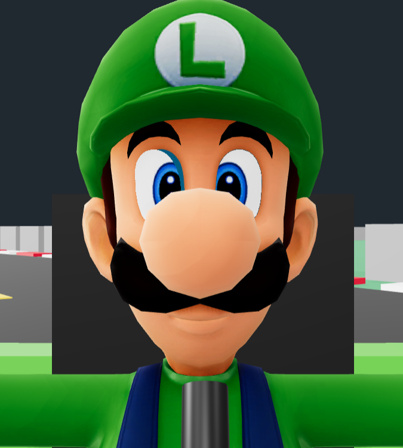

# Relatório — Mario Kart 3D

Trabalho da disciplina de Computação Gráfica. Versão inicial de um jogo de kart inspirado no clássico Mario Kart 
feito com Three.js e Vite.

*Figura 1 — Tela inicial do projeto, que é a vista acionada pela tecla **1**. Mario e
Luigi posicionados no grid, atrás da faixa quadriculada de largada. É possível verificar os
elementos da pista: asfalto, linha de largada, muros e a grama em volta. As
sombras vêm de uma DirectionalLight única que cobre o circuito inteiro.*

## Como o personagem foi modelado

O personagem completo é composto de duas partes: o kart e o piloto.

**O kart foi modelado do zero** e o código pode ser encontrado em "src/characters/Kart.js". Ele foi feito montando primitivas numa
hierarquia. A classe estende "THREE.Group" e a construção está dividida em métodos
(_buildLowerHull, _buildMainBody, _buildFrontHood, _buildSeat, _buildSteering,
_buildExhausts, _buildWheels). Todas as peças foram posicionadas em relação ao raio da
roda (this.wheelRadius) pra que o conjunto continue coerente caso precisemos mudar o tamanho.

O que muda entre Mario e Luigi ficou num objeto "PRESETS" no topo do arquivo: cor da
carroceria, cor do assento, letra do emblema e o estilo do escapamento. O emblema do capô é gerado em
tempo de execução — desenhamos o círculo branco e a letra num canvas e usamos o
resultado como "CanvasTexture". Isso foi feito para não precisarmos de um png externo.  

*Figura 2 — Mario e Luigi vistos de frente. As diferenças aparecem nas
cores e no emblema do capô, que é a textura desenhada no canvas (o "M" e o "L").
A carroceria, o capô inclinado e as rodas são as mesmas primitivas nos dois karts.*

Cada roda é um "Group" próprio (pneu, aro, cubo e uma marca radial que deixa o giro
visível), então girar a roda é só rotacionar o grupo no eixo X. A velocidade angular sai
de "v = ω·r", ou seja "ω = v / raio". Com o kart parado na largada as rodas giram no lugar para passar a ideia de que os pilotos
estão acelerando esperando a largada.

*Figura 3 — Kart de perfil, que é o ângulo onde a montagem por primitivas fica mais
clara. A marca escura atravessando o pneu é a referência que usamos pra enxergar
a rotação da roda. O chassi termina logo depois da roda dianteira.*

**Os pilotos não foram modelados pelo grupo**: eles são arquivos ".gltf" baixados do Sketchfab,
carregados em "src/characters/Character.js". O loader redimensiona o
modelo para uma altura alvo, encostando os pés no chão. 
Mais detalhes sobre os personagens podem ser vistos em "public/CREDITS.md".

A classe "Racer" é a resposável por juntar o carro e o personagem. Ele coloca kart e personagem
no mesmo grupo e usa o "seatAnchor" do kart como referência pra posicionar o piloto. 
Nessa versão inicial, não conseguimos colocar os pilotos sentados, então nós cortamos para parecer que eles estão dentro do carro. Posteriormente, queremos modelar de uma forma que fique visualmente mais bonito. 

## Primitivas, malhas e modelos externos

Kart, pista e objetos de cenário são feitos por primitivas do Three.js:

| Primitiva | Onde foi usada |
| --- | --- |
| BoxGeometry | chassi, capô, assento, base do cone, caixas de item, muros e a faixa de largada |
| CylinderGeometry | pneus, aros, cubos, coluna da direção, corpo do cone e escapamentos |
| TorusGeometry | aro do volante, pilha de pneus e os anéis do barril |
| CircleGeometry | emblema do capô, tampa do barril e a mancha de óleo |
| LatheGeometry | Curva do barril, revolucionado em torno do eixo |
| SphereGeometry | acabamento do barril |
| PlaneGeometry | grama e a faixa quadriculada da largada |

*Figura 4 — Uma cena separada que usamos durante o
desenvolvimento pra conferir os objetos sem precisar carregar a pista. Da esquerda pra
direita: cone (cilindro + caixa na base), barril (LatheGeometry revolucionada, com
anéis de TorusGeometry e tampa de CircleGeometry), pilha de pneus, mancha de óleo (um círculo achatado no chão) e a caixa de item (um cubo com interrogação). Cada objeto é uma função em "src/objects/" que devolve um
"THREE.Group".*

A malha do asfalto foi feita com "BufferGeometry": a pista é uma
"CatmullRomCurve3" fechada e, em "_buildAsphalt", percorremos a curva com "getPointAt" e
"getTangentAt", geramos dois vértices por amostra  e montamos os
índices dos triângulos.

*Figura 5 — O circuito inteiro visto de cima (tecla **2**). A mesma curva é
reaproveitada pra tudo que precisa seguir a pista: a faixa central tracejada, as zebras,
os muros, a posição dos obstáculos e o alinhamento dos pilotos no grid. A faixa
quadriculada embaixo, no meio, marca o começo da volta (u = 0).*

Para posicionar qualquer coisa na pista usamos o ponto e a tangente da curva naquele
trecho. Com a tangente dá pra calcular o vetor lateral (perpendicular a ela no plano do
chão), e aí um deslocamento lateral espalha os objetos pela largura do asfalto,
já orientados na direção certa.

*Figura 6 — Trecho inicial do circuito (tecla **3**), com os objetos já integrados à
pista. 

Modelos externos, os dois sob licença CC-BY e creditados em "public/CREDITS.md":

- **Mario**, de plumbear106 — "public/models/mario/"
- **Luigi**, de DokigerElRojito — "public/models/luigi/"

Cada um vem como ".gltf" + ".bin" + uma pasta com texturas em PNG.

## Principais dificuldades

**Personagem em T-pose.** Os dois modelos vêm com os braços abertos e as pernas retas,
sem animação. Não dá pra dobrar o joelho sem mexer no esqueleto, então "sentar" o piloto
é simulado. Nós afundamos o quadril até a altura do assento e aplicamos um clipping plane
horizontal nos materiais do personagem, escondendo tudo que fica abaixo
do banco. O plano é recalculado a cada frame porque é definido em coordenadas de mundo.

**Materiais dos ".gltf" chegando em branco.** Os dois modelos usam a extensão
"KHR_materials_pbrSpecularGlossiness", que as versões atuais do GLTFLoader não suportam
mais (o console retornou "Unknown extension"). Isso fez com que todos os materiais chegassem brancos
e sem textura. Solucionamos isso percorrendo os materiais depois do carregamento e procurando na pasta
"textures/" um arquivo com o nome do material, carregando na mão o que existir.

**O olho direito do Luigi.** Esse foi o problema mais difícil e demoramos para encontrar a 
solução. Eram dois defeitos sobrepostos:

1. O branco do olho direito tem coordenadas de textura fora do intervalo
   [0, 1]. Como o
   "TextureLoader" carrega em modo clamp por padrão, essa malha só mostrava a borda
   transparente do PNG e era inteiramente descartada , deixando aparecer
   a pele do rosto atrás. Resolvemos com "wrapS" e "wrapT" em "RepeatWrapping".
2. A íris direita não tem PNG no modelo. Já havia um código
   nosso que copiava a textura do olho esquerdo, mas sem espelhar. Clonando a textura com
   "repeat.x = -1" e "offset.x = 1", os dois olhos ficam
   simétricos. 

*Figura 7 — O rosto do Luigi depois da correção, com os dois olhos aparecendo e
simétricos. O
retângulo escuro atrás dele é o encosto do banco do próprio kart.*

**Proporção do kart.** Como tudo é posicionado por coordenadas escritas à mão, acertar as
medidas foi bastante tentativa e erro. 

## O que ainda falta implementar

O que existe hoje ainda não é um jogo. Falta:

- **Movimento.** Nada se desloca além das rodas e das caixas de item. Precisamos implementar o
  controle por teclado, aceleração, atrito e esterçamento. 
- **Colisão**: com os obstáculos e com os muros.
- **Reação do personagem**: girar o volante junto com a direção e ajustar os ossos dos
  braços pra sair da T-pose. Hoje as mãos atravessam a lateral da carroceria, o que dá
  pra notar na Figura 3.
- **Lógica de corrida**: contagem regressiva na largada, contagem de voltas, cronômetro e
  posição.
- **Itens**: as caixas giram e flutuam, mas encostar numa delas não faz nada.
- **Som**: ainda não existem.
- **Adversários**: apesar do jogador sempre controlar o Mario e o Luigi ter seu caminho pré-determinado, seria interessante acrescentar mais personagens do jogo original, como a Princesa Peach.
